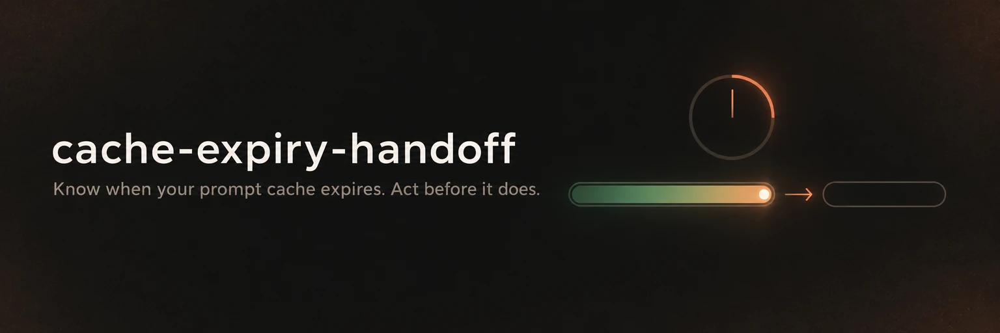
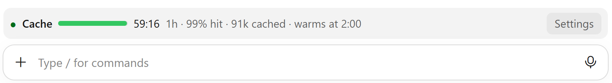
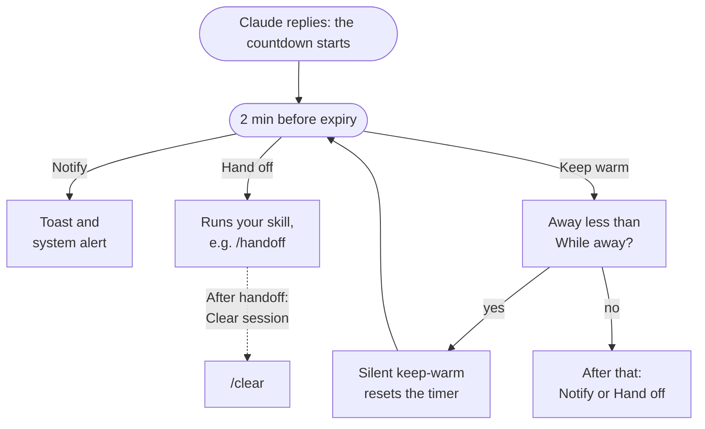
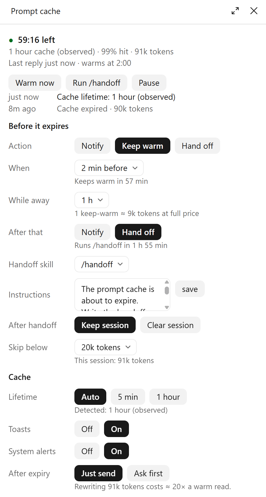

<p align="center">
  
</p>

<p align="center">
  A <a href="https://claude.com/claude-code">Claude Code</a> mod that shows how long your prompt cache has left,<br>
  and keeps it warm, hands off or warns you before it expires.
</p>

<p align="center">
  <a href="LICENSE"></a>
  <a href="https://github.com/ossianravn/cc-cache-expiry-handoff/tags"></a>
  
</p>

<p align="center">
  <a href="#install">Install</a> ·
  <a href="#how-it-works">How it works</a> ·
  <a href="#settings">Settings</a> ·
  <a href="#costs">Costs</a> ·
  <a href="#faq">FAQ</a>
</p>

<picture>
  <source media="(prefers-color-scheme: dark)" srcset="docs/band-dark.png">
  
</picture>

## Why

Claude Code caches your conversation so each new message only pays full price for what's new. The cache lasts **5 minutes** (API key, Bedrock, Vertex) or **1 hour** (Claude subscription) after the last request. Step away longer and it expires: your next message writes the whole conversation back into the cache, which costs about **12× (5 min) or 20× (1 h)** what reading it would. On a 150k-token session, that one message costs as much as twenty normal ones.

Claude Code doesn't show you that timer. This mod does, and acts on it.

## Features

- **Countdown above the prompt.** Time left, cache lifetime, hit rate and cached tokens. It turns amber shortly before expiry and red after.
- **One action before expiry**, a chosen time before the cache lapses (2 minutes by default):
  - **Notify:** a toast and a system notification.
  - **Keep warm:** a silent one-word request that reads the cache and resets its timer. Nothing appears in your conversation. It repeats while you're away, up to a limit you set.
  - **Hand off:** runs your own skill or slash command, such as `/handoff`, so a fresh session can pick up the work. It can then `/clear` the session for you.
- **Ask before a cold send.** When the cache has expired, it can ask before a message rewrites a large prompt, so you can `/compact` or `/clear` first.
- **Automatic lifetime detection** from your settings, your account type and the traffic itself.
- **A settings pane that explains itself.** A line under each setting says what it will do in this session right now.
- **Desktop app and terminal.**

## Install

You need Claude Code with mod support. The mod has been tested with versions 2.1.306 to 2.1.319.

**From a shell:**

```bash
claude plugin install cache-expiry-handoff --marketplace ossianravn/cc-cache-expiry-handoff
```

**Inside a Claude Code session:**

```text
/plugin marketplace add ossianravn/cc-cache-expiry-handoff
/plugin install cache-expiry-handoff@cc-cache-expiry-handoff
/reload-plugins
```

**In the desktop app:** click **+** next to the prompt box, choose **Plugins** → **Add marketplace**, enter `ossianravn/cc-cache-expiry-handoff`, then add **cache-expiry-handoff**.

The band appears above the prompt after Claude's next reply.

## Quick start

1. **Send a message.** Once Claude replies, the band starts counting down.
2. **Press Settings** on the band, or run `/cache-expiry`.
3. **Pick an action.** **Keep warm** with **While away: 1 h** is a good start. With a 1-hour cache, that's one keep-warm each time you step away.

## How it works



Notify and Hand off run once per idle stretch, and Keep warm repeats until **While away** runs out. Your next message starts a new stretch.

**Keep warm, step by step**, with a 1-hour cache, **When: 2 min before** and **While away: 1 h**:

| Time since your last message | What happens |
| --- | --- |
| 0 | Claude replies. The cache has 60 minutes left. |
| 58 min | You've been away less than 1 h, so it keeps the cache warm. The cache now runs to 118 min. |
| 116 min | You've been away more than 1 h, so it does **After that** (notify or hand off). |
| 118 min | The cache expires. |

A keep-warm is a tool-less, one-word request sent over the session's own transcript. It reads the cached prompt, which resets the cache's timer, and its answer is thrown away.

## Settings

Open the pane with **Settings** on the band or with `/cache-expiry`. Settings are saved, and new sessions start with them.

<p align="center">
  <picture>
    <source media="(prefers-color-scheme: dark)" srcset="docs/pane-dark.png">
    
  </picture>
</p>

**Before it expires**

| Setting | Default | What it does |
| --- | --- | --- |
| Action | Notify | Notify, Keep warm or Hand off. |
| When | 2 min before | How long before expiry the action runs (2 to 15 min). |
| While away | 1 h | Keep warm only: how long after your last message it keeps the cache warm. |
| After that | Notify | Keep warm only: what happens once that time is up. |
| Handoff skill | `/handoff` | The skill or slash command to run. |
| Instructions | *(a short note)* | Text passed to the skill as its arguments. |
| After handoff | Keep session | **Clear session** runs `/clear` once the skill finishes. |
| Skip below | 20k tokens | Smaller sessions only get a notification. |

**Cache**

| Setting | Default | What it does |
| --- | --- | --- |
| Lifetime | Auto | Auto, 5 min or 1 hour. |
| Toasts | On | In-app toasts. |
| System alerts | On | System notifications. |
| After expiry | Just send | **Ask first** asks before a message rewrites an expired cache. |

The pane also has **Warm now**, **Run /handoff** and **Pause** buttons and a short log of what the mod did.

### Commands

| Command | Does |
| --- | --- |
| `/cache-expiry` | Opens the settings pane. |
| `/cache-expiry status` | Prints the cache state. |
| `/cache-expiry warm` | Keeps the cache warm now. |
| `/cache-expiry handoff` | Runs the handoff skill now. |
| `/cache-expiry mode <notify\|warm\|handoff\|warm-handoff>` | Sets the action. `warm-handoff` is Keep warm with **After that: Hand off**. |
| `/cache-expiry pause` / `resume` | Pauses or resumes actions for this session. |

### A handoff skill

**Hand off** runs any skill or slash command you have. If you don't have one yet, this one writes a `HANDOFF.md` that a fresh session can read. Save it as `~/.claude/skills/handoff/SKILL.md`:

```markdown
---
name: handoff
description: Write HANDOFF.md so a fresh session can continue this work.
---

Write HANDOFF.md in the project root for an agent with no memory of this session:
the goal, what is done, what is left, decisions made and why, and the files that matter.
Keep it under one page. Then reply with one line saying where it is.
```

Pair it with **After handoff: Clear session**, and your next message starts a fresh session that can read the handoff, instead of rewriting the old cache.

### In the terminal

The band draws as text:

```text
● Cache ████████░░░░ 41:12 1h · 96% hit · 151k cached · warms at 2:00 [ Settings ]
```

The settings pane opens inline above the prompt, with the same controls.

## Cache lifetime

On **Auto**, the mod works out the lifetime in this order:

1. **Your settings:** `FORCE_PROMPT_CACHING_5M`, `CLAUDE_CODE_PROMPT_CACHE_TTL`, the `promptCacheTtl` setting, then `ENABLE_PROMPT_CACHING_1H`.
2. **The traffic:** a cache hit after more than five idle minutes proves a 1-hour cache.
3. **Your account:** a Claude subscription means 1 hour. An API key, Bedrock, Vertex or Foundry means 5 minutes.

The pane shows what it detected and why, such as *Detected: 1 hour (observed)*.

## Costs

> [!NOTE]
> Keep-warm requests are real requests. They're billed to your API account, or counted against your plan's usage, like any other message.

Each keep-warm reads the cached prompt at the cache-read rate, about a tenth of the normal input price, and answers with one word. The pane shows the estimate before it runs, such as *1 keep-warm ≈ 9k tokens at full price*, and totals what it has spent.

How many keep-warms **While away** costs, with **When: 2 min before**:

| While away | 1-hour cache | 5-minute cache |
| --- | --- | --- |
| 1 h | 1 | 19 |
| 8 h | 8 | 159 |
| 24 h | 24 | 479 |

With a 1-hour cache, even 24 hours costs about as much as one expired rewrite. With a 5-minute cache, keep **While away** short.

## FAQ

<details>
<summary><b>Does a keep-warm show up in my conversation?</b></summary>

No. It's sent beside the conversation, not into it, and its answer is discarded. Only the timer changes.
</details>

<details>
<summary><b>What happens if I come back in the middle of a keep-warm or handoff?</b></summary>

Your message goes through as usual. Sending a message also starts a new idle stretch, so the mod acts again only after your next reply.
</details>

<details>
<summary><b>Does it send data anywhere?</b></summary>

No. The mod makes no network calls of its own. Keep-warms go through Claude Code's own model connection. Settings and the last countdown of each session are stored in a JSON file under `~/.claude/plugins/store/`.
</details>

<details>
<summary><b>The band says "Waiting for the first reply".</b></summary>

The mod learns the cache state from Claude's replies. It shows the countdown after the next one.
</details>

<details>
<summary><b>Can I use it alongside other cache mods?</b></summary>

Yes, but you'll see two bands. If you use `prompt-cache-control`, you may want to turn one off.
</details>

## Develop

```bash
git clone https://github.com/ossianravn/cc-cache-expiry-handoff.git
cd cc-cache-expiry-handoff
claude plugin validate .
claude plugin test .
claude --plugin-dir .
```

| Path | Holds |
| --- | --- |
| `hooks/logic.ts` | Lifetime detection, the before-expiry decision, the schedule and the pane's lines. Pure functions, no Claude Code API. |
| `hooks/register.tsx` | The hooks, the band and the settings pane. |
| `hooks/register.test.tsx` | Tests for both. |
| `types/index.d.ts` | The mod's settings and state types. |

Issues and pull requests are welcome.

## Credits

Inspired by [cache-tax](https://github.com/karanb192/cache-tax), for keep-warm and the cold-send guard, and by the `prompt-cache-control` mod in [claude-code-templates](https://github.com/davila7/claude-code-templates), for the countdown band and lifetime detection.

## License

[MIT](LICENSE) © Ossian Ravn
